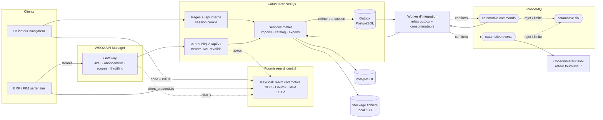
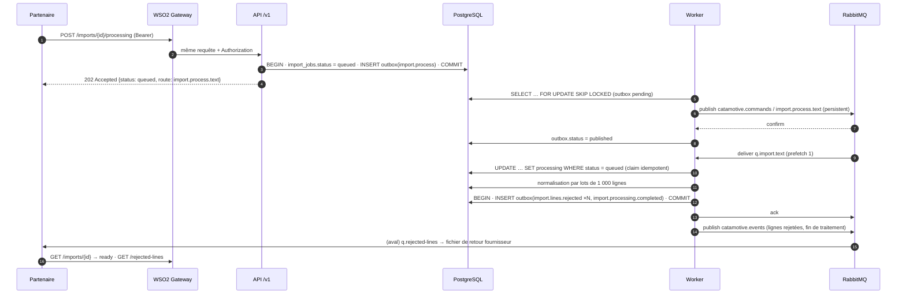
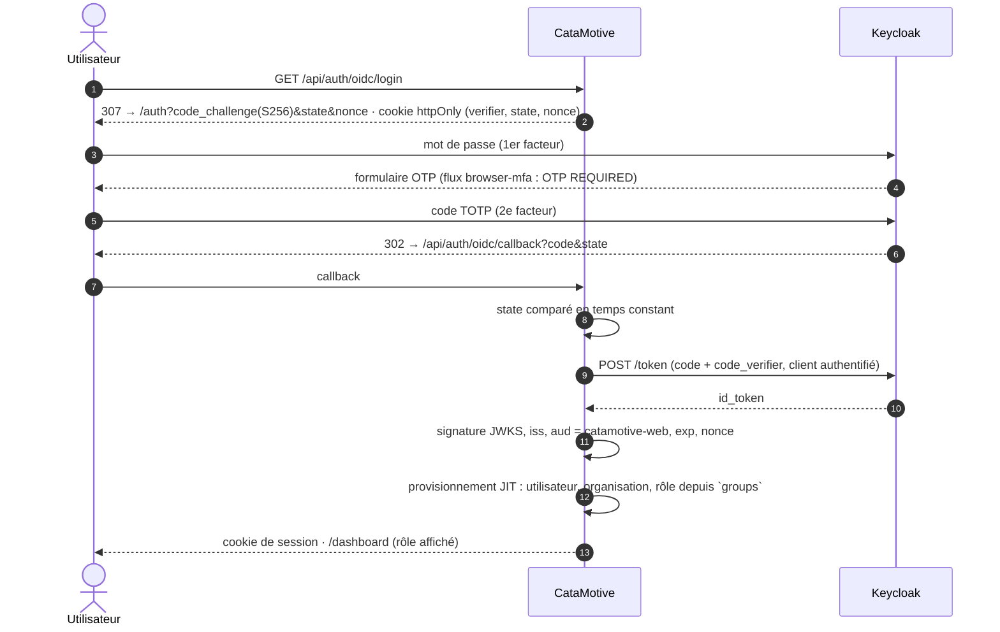

# Couche d'intégration CataMotive — architecture

Branche `integration-lab`. Ce document décrit comment CataMotive s'ouvre aux systèmes tiers (ERP, PIM, intégrateurs) : API publique conçue avant le code, traitements asynchrones par messagerie, identité fédérée avec MFA, et passerelle d'API avec throttling.

Le métier ne change pas. Un catalogue fournisseur hétérogène (CSV, XLS, ODS…) est diagnostiqué puis projeté sur un **modèle pivot** de 20 champs (_canonical data model_). Il est ensuite normalisé, contrôlé et exporté vers une cible (WooCommerce, PrestaShop, Shopify, CSV générique ou personnalisé). Ce qui change, c'est **la façon d'y accéder et de l'exécuter**.

- [Vue d'ensemble](#vue-densemble)
- [Flux 1 — traitement asynchrone](#flux-1--traitement-asynchrone-dun-import)
- [Messagerie : topologie et garanties](#messagerie--topologie-et-garanties)
- [Flux 2 — connexion SSO avec MFA](#flux-2--connexion-sso-avec-mfa)
- [Flux 3 — appel partenaire via la passerelle](#flux-3--appel-partenaire-via-la-passerelle)
- [Modèle de sécurité](#modèle-de-sécurité)
- [Modèles de déploiement](#modèles-de-déploiement)
- [Observabilité](#observabilité)
- [Limites connues](#limites-connues)

Décisions et alternatives : [ADR.md](ADR.md). Mise en route : [RUNBOOK.md](RUNBOOK.md). Contrat : [`openapi/catamotive-public-api.v1.yaml`](../../openapi/catamotive-public-api.v1.yaml).

## Vue d'ensemble

| Composant               | Rôle                                                                            | Code                                                  |
| ----------------------- | ------------------------------------------------------------------------------- | ----------------------------------------------------- |
| Contrat OpenAPI 3.1     | Source de vérité de l'API publique, importée telle quelle dans WSO2             | `openapi/`                                            |
| API publique v1         | 9 chemins REST, Problem Details (RFC 9457), corrélation, 202 Accepted           | `src/app/api/v1/**`, `src/server/api/v1.ts`           |
| Outbox transactionnelle | Message écrit dans la transaction métier, relayé avec confirmation du broker    | `src/server/integration/outbox.ts`                    |
| Routeur de contenu      | Choisit file et clé de routage selon le contenu (format source, cible d'export) | `src/server/integration/router.ts`                    |
| Topologie RabbitMQ      | Exchanges, files quorum, DLX, échange alternatif, déclarés comme des données    | `src/server/integration/topology.ts`                  |
| Consommateurs           | Traitement d'import, génération d'export, idempotents                           | `src/server/integration/handlers.ts`                  |
| Worker                  | Relais outbox + consommateurs + notifications                                   | `scripts/integration-worker.ts`                       |
| OIDC / JWT              | Code + PKCE, vérification JWKS, provisionnement juste-à-temps                   | `src/server/auth/oidc.ts`, `src/app/api/auth/oidc/**` |
| RBAC                    | Matrice rôle → permission, par organisation                                     | `src/server/auth/rbac.ts`                             |
| Keycloak                | Realm, scopes, MFA, clients, groupes organisation/rôle                          | `infra/keycloak/`                                     |
| WSO2 API Manager        | Key Manager Keycloak, politiques de throttling, publication depuis le contrat   | `infra/wso2-apim/`                                    |

Le pilote Vercel n'a ni broker ni fournisseur d'identité. Tout est donc activé par configuration : sans `OIDC_ISSUER`, l'API publique répond 503 et la connexion SSO n'apparaît pas. Sans `JOB_DISPATCH=queue`, le traitement reste synchrone, comme aujourd'hui (voir ADR-007).

## Flux 1 — traitement asynchrone d'un import

Le format source, issu du diagnostic, détermine la file. Les CSV, TSV et TXT délimités vont dans `q.import.text`. Les XLSX, XLS et ODS, décompressés et parsés avec plus de mémoire, vont dans `q.import.spreadsheet`. Les deux files peuvent ainsi être dimensionnées séparément : `WORKER_QUEUES=q.import.spreadsheet npm run worker:queue` lance un worker dédié aux tableurs.

## Messagerie : topologie et garanties

| File                   | Liée à                                                      | Type    | Contenu                                  |
| ---------------------- | ----------------------------------------------------------- | ------- | ---------------------------------------- |
| `q.import.text`        | commands `import.process.text`                              | quorum  | Commandes d'import de fichiers délimités |
| `q.import.spreadsheet` | commands `import.process.spreadsheet`                       | quorum  | Commandes d'import de classeurs          |
| `q.export.cms`         | commands `export.generate.{woocommerce,prestashop,shopify}` | quorum  | Exports avec précontrôles CMS            |
| `q.export.file`        | commands `export.generate.{generic,custom}`                 | quorum  | Exports fichier                          |
| `q.rejected-lines`     | events `import.lines.rejected`                              | quorum  | Lignes invalides par lots de 500         |
| `q.notifications`      | events `import.processing.*`, `export.*`                    | quorum  | Fin de traitement, succès ou échec       |
| `q.dead-letter`        | dlx `#`                                                     | classic | Messages rejetés ou empoisonnés          |
| `q.unroutable`         | échange alternatif                                          | classic | Messages sans destinataire               |

**Patterns d'intégration (Hohpe & Woolf) appliqués**

- _Canonical Data Model_ : le modèle pivot de 20 champs. Chaque format entrant y est projeté par le mapping, chaque cible sortante en est dérivée par un profil d'export.
- _Message Translator_ : la normalisation (références, marques, EAN, décimaux, devises, TVA, HTML…), avec une règle et une version tracées par transformation.
- _Content-Based Router_ : `routeMessage()`. Les producteurs décrivent ce qu'il faut faire, jamais où l'envoyer.
- _Splitter_ : un ZIP produit un import par entrée, et les lignes rejetées sont découpées en lots de 500.
- _Invalid Message Channel_ : `q.rejected-lines` pour les données métier invalides, et `reject` immédiat vers la DLQ pour un message hors contrat (schéma zod).
- _Dead Letter Channel_ : `catamotive.dlx` → `q.dead-letter`, avec l'en-tête `x-death` (raison `rejected` ou `delivery_limit`).
- _Guaranteed Delivery_ : messages persistants, files quorum (Raft) et publisher confirms.
- _Transactional Outbox_ : pas de double écriture base + broker non atomique.
- _Idempotent Receiver_ : la reprise du travail passe par un `UPDATE … WHERE status = 'queued'`. Un doublon ne trouve rien à prendre et est acquitté.
- _Competing Consumers_ : plusieurs workers sur une même file, `prefetch 1`, `SKIP LOCKED` pour le relais.

**Sémantique de livraison**

| Situation                                   | Décision du consommateur | Effet                                                                                                                          |
| ------------------------------------------- | ------------------------ | ------------------------------------------------------------------------------------------------------------------------------ |
| Succès, ou doublon déjà traité              | `ack`                    | Message retiré                                                                                                                 |
| Erreur métier (fichier illisible, 409, 422) | `ack` + état `failed`    | Résultat enregistré, événement `*.failed` publié                                                                               |
| Erreur d'infrastructure (stockage, réseau…) | `retry` (nack + requeue) | Relivré ; au-delà de 3 relivraisons, DLQ et `failed`                                                                           |
| Message hors contrat                        | `reject`                 | DLQ immédiatement                                                                                                              |
| Broker indisponible au relais               | —                        | Outbox conservée, backoff 2 s → 5 min, ordre préservé                                                                          |
| Worker tué pendant un traitement            | —                        | Message non acquitté relivré ; la nouvelle livraison reprend le job, l'ancien propriétaire perd la main (contrôle du `run_id`) |

La livraison est **au moins une fois**. Un crash entre la confirmation du broker et le commit de l'outbox republie un message ; les consommateurs idempotents l'absorbent. Pour un export relivré après un crash, un second fichier identique peut être produit : c'est sans conséquence métier, et documenté dans les limites.

## Flux 2 — connexion SSO avec MFA

Les organisations et les rôles viennent du fournisseur d'identité, sous la forme de groupes `/organizations/<uuid>/<admin|operator|reviewer>` exposés dans le claim `groups`. À chaque connexion, l'application synchronise sa copie :

- une organisation qui disparaît du jeton passe en `revoked` et ses sessions sont fermées (processus de départ) ;
- un changement de rôle est appliqué et audité (`membership.role_synced`) ;
- un compte local existant n'est rattaché que si le fournisseur certifie l'email (`email_verified`) ;
- un compte SSO ne peut jamais se connecter par mot de passe (son empreinte n'est pas un hash scrypt).

## Flux 3 — appel partenaire via la passerelle

1. Le partenaire obtient un jeton `client_credentials` auprès de Keycloak, avec les scopes `catalog:read`, `catalog:write` et `catalog:export`, l'audience `catamotive-api` et le claim `groups` de son compte de service.
2. **WSO2 Gateway** : signature et émetteur vérifiés localement via le JWKS du Key Manager « Keycloak ». L'application APIM est retrouvée par le claim `azp`, puis l'abonnement est contrôlé. Le scope de la ressource vient du contrat OpenAPI. La politique de throttling est appliquée : `CataMotiveGold` à 100/min, `CataMotiveBronze` à 5/min.
3. Le jeton est **transmis** au backend (`enable_outbound_auth_header = true`).
4. **Backend** : nouvelle vérification complète (signature, iss, aud, exp), scope, organisation (`X-Organization-ID` obligatoire si le jeton en couvre plusieurs), puis rôle RBAC.

Les clients Keycloak existants sont **associés** aux applications APIM (_map keys_) plutôt que recréés. Un même partenaire a donc une seule identité, gérée dans l'IdP.

## Modèle de sécurité

| Contrôle                     | Où                     | Ce qui est vérifié                                                                                 |
| ---------------------------- | ---------------------- | -------------------------------------------------------------------------------------------------- |
| Authentification utilisateur | Keycloak               | Mot de passe (12 caractères min.) + TOTP obligatoire, protection force brute                       |
| Authentification machine     | Keycloak               | `client_credentials`, secret par client                                                            |
| Validation du jeton          | Gateway **et** backend | RS256 via JWKS, émetteur, audience, expiration (tolérance 30 s)                                    |
| Abonnement et quota          | Gateway                | Application abonnée, politique de throttling (429 + `Retry-After`)                                 |
| Scope OAuth2                 | Gateway **et** backend | Ce que l'application cliente a le droit de faire                                                   |
| Rôle RBAC                    | Backend                | Ce que le principal a le droit de faire dans l'organisation                                        |
| Isolation multi-organisation | Backend + base         | `organization_id` vient du jeton ou de la session, jamais du client ; clés étrangères composées    |
| CSRF                         | Backend (interface)    | Contrôle de l'en-tête `Origin` sur les mutations par cookie ; l'API Bearer n'utilise pas de cookie |
| Intégrité des messages       | Worker                 | Schéma zod à la publication et à la consommation ; version de schéma                               |

**Matrice RBAC**

| Permission                                      | admin | operator | reviewer |
| ----------------------------------------------- | :---: | :------: | :------: |
| Consulter imports, rapports, exports            |   ✓   |    ✓     |    ✓     |
| Revoir une ligne (accepter, corriger, exclure)  |   ✓   |    ✓     |    ✓     |
| Déposer, mapper, lancer un traitement, exporter |   ✓   |    ✓     |          |
| Supprimer un import, gérer l'organisation       |   ✓   |          |          |

Un scope sans le rôle, ou un rôle sans le scope, est refusé (403). Par exemple, le client `partner-readonly-demo` a le scope `catalog:read` et le rôle `reviewer` : il peut lire, mais pas déposer de fichier.

**Authentification adaptative (piste suivante)** : le flux actuel exige l'OTP pour toute connexion interactive. L'étape suivante serait une montée en garantie (_step-up_) basée sur le niveau d'authentification (`acr` / LoA de Keycloak, ou scripts adaptatifs de WSO2 Identity Server) : mot de passe seul pour consulter, OTP exigé pour supprimer ou administrer, ou en cas de risque (nouvel appareil, pays inhabituel).

## Modèles de déploiement

| Modèle  | Composition                                                                                                                                                   | Atouts / exigences                                                                                                                                      |
| ------- | ------------------------------------------------------------------------------------------------------------------------------------------------------------- | ------------------------------------------------------------------------------------------------------------------------------------------------------- |
| Cloud   | Next.js sur Vercel, PostgreSQL et Storage Supabase, RabbitMQ managé (CloudAMQP, Amazon MQ), Keycloak ou WSO2 Asgardeo, WSO2 Choreo ou Bijira comme passerelle | Rien à opérer. Il faut un worker hébergé durable (Vercel ne garde pas de processus) et une région UE pour les données                                   |
| On-prem | Conteneurs (`infra/docker-compose.integration.yml`, puis Kubernetes) : PostgreSQL, RabbitMQ en cluster de 3 nœuds pour les files quorum, Keycloak, WSO2 APIM  | Données chez le client. L'exploitation, les sauvegardes et les mises à jour de sécurité restent à sa charge                                             |
| Hybride | Plan de contrôle WSO2 (Publisher, Devportal, Key Manager) dans le cloud, gateway et workers chez le client, près des ERP                                      | Les fichiers ne quittent pas le réseau du client ; la gouvernance des API reste centralisée. Il faut un lien sécurisé entre gateway et plan de contrôle |

## Observabilité

- `X-Correlation-ID` est fourni par l'appelant ou généré, puis renvoyé dans chaque réponse, porté comme `correlationId` AMQP et propagé aux événements en aval.
- Les journaux du worker sont des lignes JSON : `import.processing.started/completed/failed/retry`, `message.duplicate`, `message.rejected`, `outbox.relay.error`.
- Les en-têtes AMQP portent `x-organization-id`, `x-schema-version` et, en DLQ, `x-death` (file d'origine, raison, compteur).
- L'audit métier existant est enrichi : `export.requested`, `membership.provisioned`, `membership.role_synced`.
- Côté passerelle, les analytics WSO2 (non activées dans ce lab) fourniraient latence, erreurs et consommation par abonnement.

## Limites connues

- Le lab s'exécute en local. Le pilote de production reste en mode `inline` sans SSO. Passer en `queue` suppose un broker et un worker hébergés.
- Un export relivré après un crash du worker peut produire un second fichier identique (pas de clé d'idempotence côté stockage).
- L'organisation créée à la première connexion SSO porte un nom provisoire ; l'administrateur le renomme dans les paramètres.
- Un utilisateur membre de plusieurs organisations ouvre sa session sur la première. Un sélecteur d'organisation reste à faire.
- `docker-compose.integration.yml` n'a pas été exécuté dans l'environnement de développement de ce lab, où Docker Hub et quay.io étaient inaccessibles. Les mêmes versions ont été vérifiées à partir de leurs distributions officielles (voir [VERIFICATION.md](../VERIFICATION.md)).
