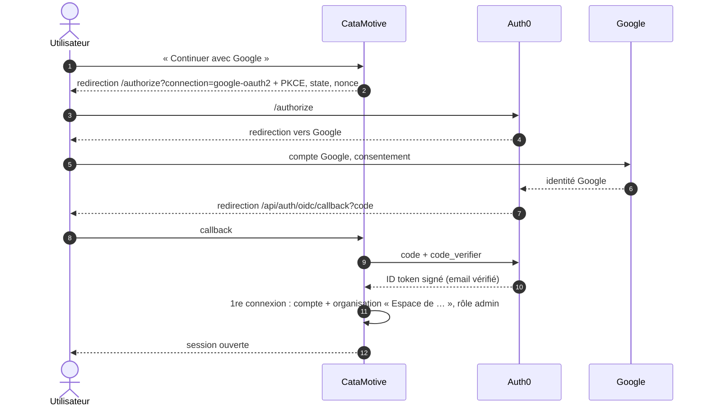

# Connexion avec Auth0 et Google

CataMotive accepte n'importe quel fournisseur OpenID Connect. Avec Auth0, l'utilisateur peut créer son compte ou se connecter avec Google (ou Microsoft, GitHub…) sans mot de passe CataMotive.



## Règles appliquées par l'application

| Situation à la connexion SSO                                  | Résultat                                                         |
| ------------------------------------------------------------- | ---------------------------------------------------------------- |
| Première connexion, email vérifié, sans groupe d’organisation | Compte créé, organisation personnelle créée, rôle **admin**      |
| Connexions suivantes                                          | Même compte (identifiant `sub`), mêmes organisations             |
| Email déjà utilisé par un compte local et vérifié par l'IdP   | Le compte existant conserve sa méthode de connexion              |
| Jeton avec groupes `/organizations/<id>/<rôle>`               | Rôles gérés par l’IdP, révocation y compris du dernier rôle      |
| Client machine (`client_credentials`) sans groupe             | Refusé (403) : jamais d'inscription automatique pour une machine |

Désactiver l'inscription libre : `OIDC_SELF_SIGNUP=false`.

## Mise en place (environ 15 minutes)

1. **Créer un tenant** sur auth0.com, région Europe.
2. **Applications > Create Application** : « CataMotive », type _Regular Web Application_. Dans _Settings_ :
   - Allowed Callback URLs : `https://catalog-drive.vercel.app/api/auth/oidc/callback, http://127.0.0.1:3000/api/auth/oidc/callback`
   - Allowed Logout URLs : `https://catalog-drive.vercel.app/connexion, http://127.0.0.1:3000/connexion`
   - Allowed Web Origins : `https://catalog-drive.vercel.app`
   - Noter **Domain**, **Client ID**, **Client Secret**.
3. **Authentication > Social > Google** : la connexion `google-oauth2` existe avec des clés de développement Auth0, suffisantes pour un pilote. Pour la production, créer un client OAuth dans Google Cloud Console et coller ses clés.
4. Dans l'application, onglet **Connections** : activer `google-oauth2` (et `Username-Password-Authentication` si l'on veut l'email + mot de passe Auth0).
5. Facultatif : **Security > Multi-factor Auth** pour exiger un code OTP.
6. Facultatif : **Actions > Library > Build Custom** « Post Login » avec [`infra/auth0/post-login-action.js`](../../infra/auth0/post-login-action.js), pour gérer des organisations d'entreprise.
7. **Vercel > Environment Variables** (Production), puis redéployer :

```text
OIDC_ISSUER=https://<domain Auth0>/
OIDC_CLIENT_ID=<client id>
OIDC_CLIENT_SECRET=<client secret>
OIDC_SOCIAL_CONNECTIONS=google-oauth2:Google
# seulement avec l'Action de l'étape 6
OIDC_GROUPS_CLAIM=https://catamotive.app/groups
```

Les boutons « Continuer avec Google » et « Continuer avec un autre compte (SSO) » apparaissent alors sur les pages de connexion et d'inscription. La connexion par email et mot de passe CataMotive reste disponible.

Pour l'API publique avec Auth0 : créer une API d'identifiant `catamotive-api` avec les permissions `catalog:read`, `catalog:write`, `catalog:export`, et des applications _Machine to Machine_ pour les partenaires.

## Compatibilité

| Fournisseur        | `OIDC_CONNECTION_PARAM` | Valeur d'un bouton social          |
| ------------------ | ----------------------- | ---------------------------------- |
| Auth0 (défaut)     | `connection`            | `google-oauth2`, `windowslive`…    |
| Keycloak           | `kc_idp_hint`           | alias du fournisseur, ex. `google` |
| WSO2 Asgardeo / IS | `fidp`                  | nom du fournisseur fédéré          |

L'émetteur d'Auth0 se termine par `/` : l'application l'accepte avec ou sans barre finale et vérifie le jeton contre la valeur exacte annoncée par la découverte OIDC.

## Preuve

`node --import tsx scripts/verify-sso.ts --self-signup` (Keycloak du lab, utilisateur `sam.social` sans groupe) : mot de passe, OTP, callback, organisation « Espace de Sam Social » créée avec le rôle admin, dépôt d'un fichier accepté (201), et le bouton social transmet bien l'indice de fournisseur. Tests : `tests/integration/identity.test.ts` et `tests/unit/rbac.test.ts`.
